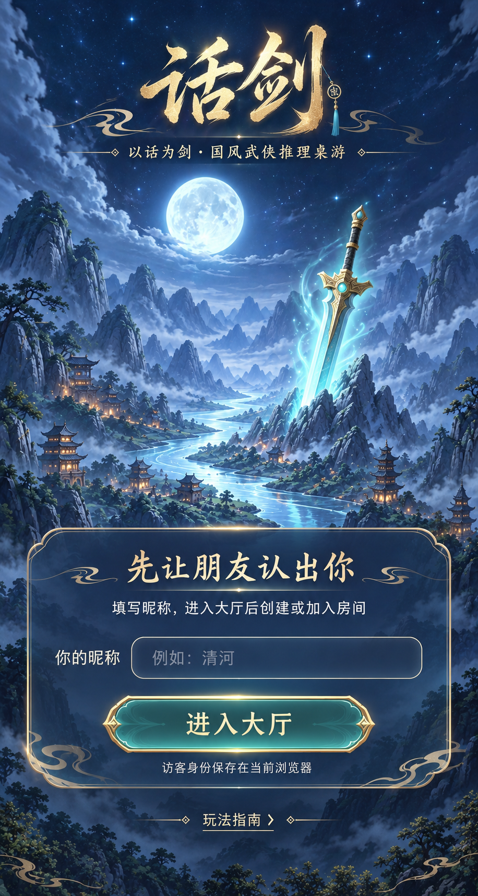
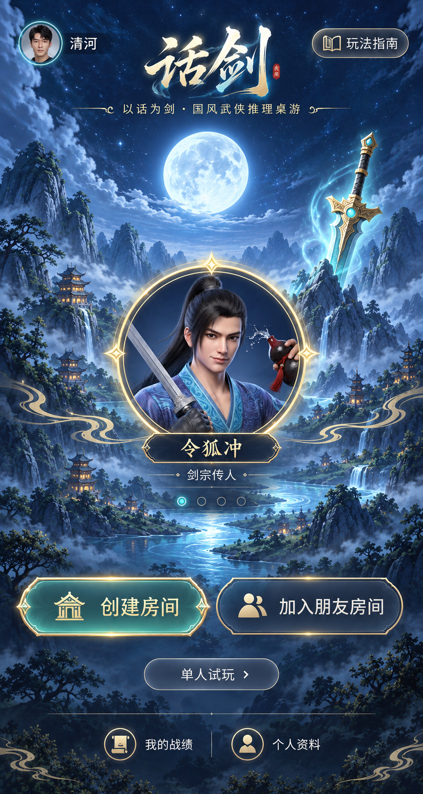
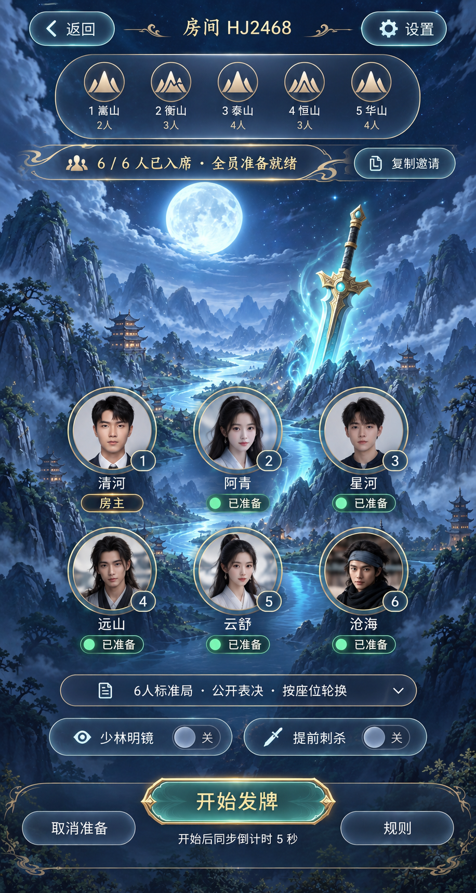
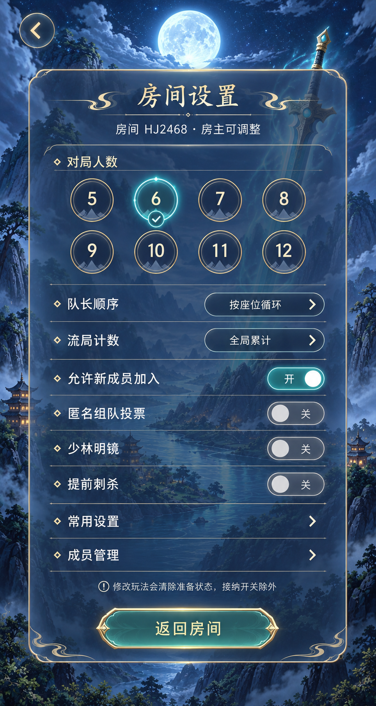
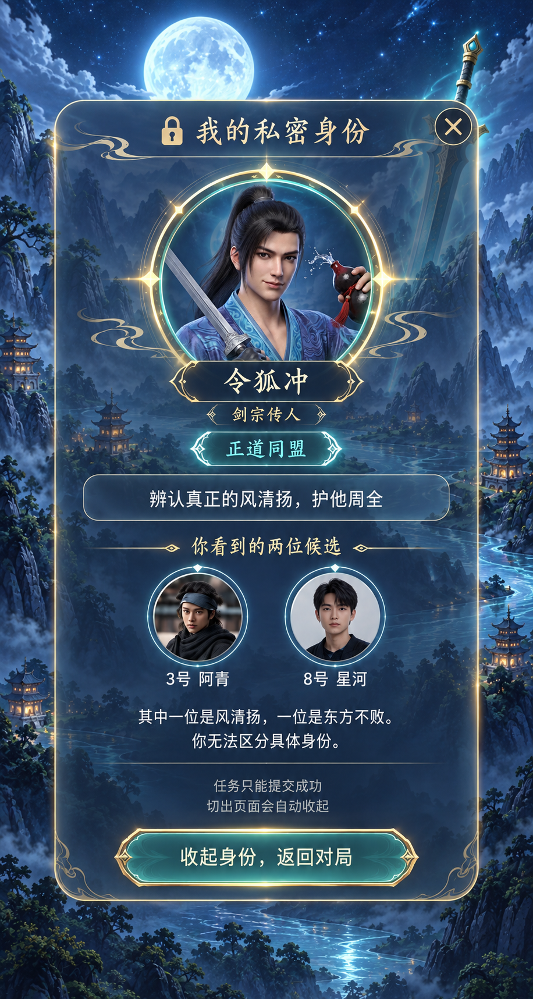
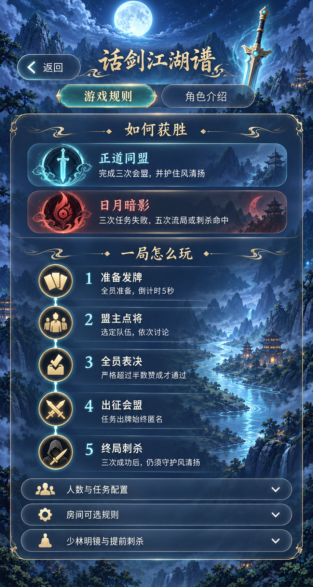
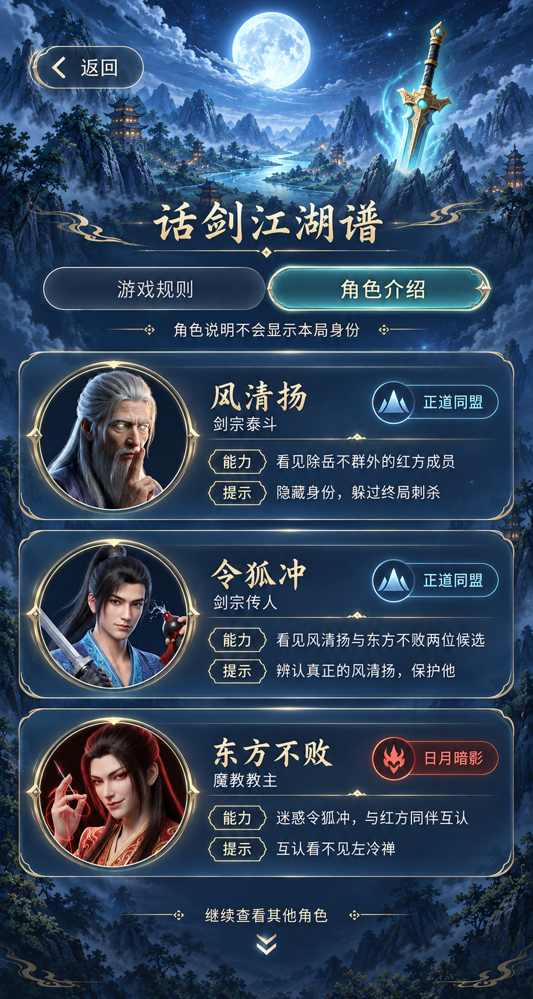
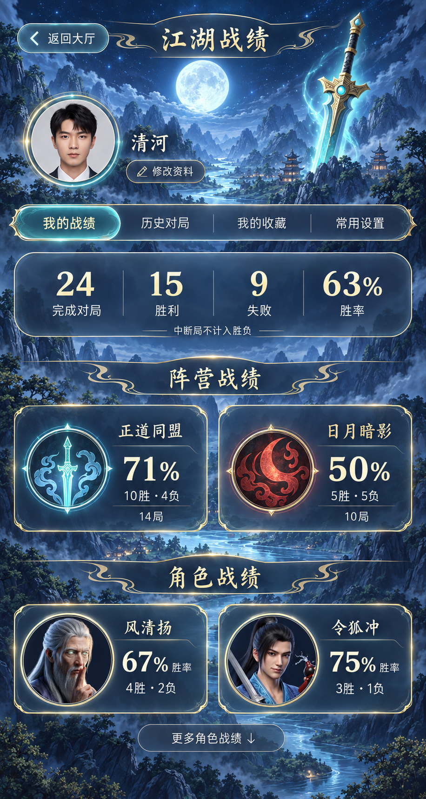
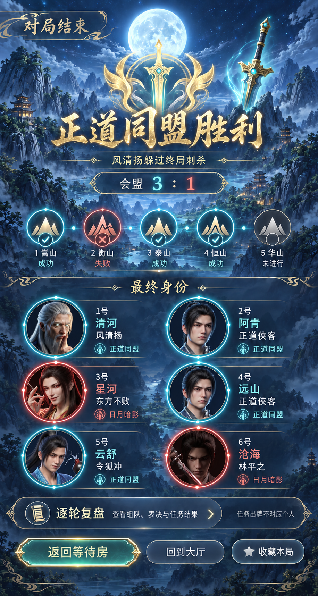

# 《话剑》核心页面统一风格确认稿

日期：2026-10-17。状态：**全部最终设计已获用户确认并授权实施，已完成本地代码和验证；尚未更新 Docker/ngrok。**

实现状态与浏览器实拍以[六场景 UI 落地记录](../../docs/huajian-scenes-ui-validation.md)为准。以下保留原设计确认过程，其中“未改代码”等说明描述设计阶段当时的状态。

最新背景分配与战况详情见[六场景背景与战况详情确认稿](../huajian-scenes-battle-review-20261017/README.md)。下方九张保留为布局基准，原统一背景由新稿中的 A–F 六场景替代；战况详情两版待确认后再统一实施。

## 已确认的基准

用户已确认[对局组合稿](../huajian-hybrid-review-20261016/hybrid-preview.png)：明亮月光剑景、五岳徽章、下方悬浮玩家列表，加中部「队长金色大头像 + 青色出征槽位」横幅。其他核心页面的字体、图案与排布也已获认可，最终采用六张背景按场景分配。对局中部选人横幅属于已确定方案，不能再次遗漏。

## 九张页面预览

点击图片或页面名称查看大图。

| 01 昵称入口 | 02 游戏大厅 | 03 房间等待 |
| --- | --- | --- |
|  |  |  |
| 先填写昵称，再进入大厅 | 创建与加入入口均清晰可见 | 全员准备、邀请及5秒发牌提示 |

| 04 房间设置 | 05 私密身份牌 | 06 游戏规则 |
| --- | --- | --- |
|  |  |  |
| 人数徽章、规则开关及设置入口 | 角色图案与本人可见信息 | 获胜条件、五步流程及详细规则入口 |

| 07 角色介绍 | 08 个人中心与战绩 | 09 终局与复盘入口 |
| --- | --- | --- |
|  |  |  |
| 紧凑横向图文，沿用已选角色画像 | 阵营、角色战绩分别展示 | 结果、最终身份、逐轮复盘入口 |

## 只读检查与对应设计

检查依据是当前工作区组件和样式，未改代码；本轮没有重新执行应用浏览器验收。

| 当前来源 | 观察到的界面问题 | 设计方案 |
| --- | --- | --- |
| main.tsx / style.css | 大厅仍有独立主页样式，创建按钮明显，加入入口较弱 | 月光剑景统一背景；创建与加入均为明显入口 |
| main.tsx 等待区 | 已有悬浮头像，但标题、设置按钮、扩展玩法仍采用另一套控件 | 统一五岳徽章、玩家圆环、青玉按钮，房主与队长含义保持不同 |
| 房间设置 / SettingsFields | 通用表单视觉较重 | 人数徽章、明确开关与简洁选择行；保留即时生效机制 |
| GamePanel 身份区域 | 通用弹层与新对局风格有差距 | 角色画像为主、私密视野为辅；候选人只显示玩家头像及座位 |
| GuidePanel | 规则以长文章为主，角色介绍区有多重深色块 | 流程图示加折叠详情；角色采用紧凑图文行 |
| AccountPanel | 资料编辑与统计较密集，面板样式偏通用 | 资料编辑独立入口；统计分层，并保留历史、收藏、常用设置 |
| GamePanel / ReplayView | 终局与复盘尚未与整套风格统一 | 五岳结果轨迹、终局身份、明确复盘入口；详细记录继续完整保留 |

技术环境：React + Vite + TypeScript，现有原生 CSS、Heraldry 与 RolePortrait 组件；已有 Ma Shan Zheng / ZCOOL XiaoWei 标题字体声明和 Noto Sans SC 等正文字体回退。本轮不引入新的技术栈或字体购买。

## 统一视觉约定

- 明亮青蓝月光、山水与巨剑贯穿全局，背景保持通透；信息密集区域局部降低背景细节，保证文字对比。
- 浅金用于边框、标题、队长和装饰；青玉用于主要操作与选中态；红色只用于日月暗影、反对及失败等明确语义。
- 人物圆形框、轻量云纹、五岳山峰图案贯穿不同页面。选中、准备、成功等状态同时有文字或符号，不单靠发光和颜色。
- 标题使用现有游戏风格字体，正文使用清晰易读的中文无衬线字体。实际实现保持手机正文可读、操作触区充足。
- 角色沿用当前已选原图。预览里的玩家人像、昵称和数字为占位示意，不代表真实账号或历史战绩。
- 不新增会员、付费、排行榜、聊天或认证流程。

## 功能与实现约束

- 先昵称、后大厅，创建/加入逻辑保持不变。
- 等待房尚未发牌，不提前展示个人身份或指定当前任务队长。全员准备后开始，同步5秒倒计时。
- 玩法修改清除准备状态；允许新成员加入开关不清除准备。设置沿用即时生效，不新增虚假的“保存后生效”操作。
- 公开玩家列表与私密角色信息严格区分；身份牌切出或断线按既有逻辑收起。
- 图中规则为摘要，完整角色规则、配置、扩展玩法和复盘记录仍保留。人数、任务与双败门槛从现有规则读取，不以示例图替代规则配置；例如当前十二人局第三、四轮都需两张失败牌。
- 阵营战绩与角色战绩保持独立区块。中断局不计入胜负和胜率。
- 终局才能公开完整身份，任务牌不关联个人；返回等待房后仍按现有准备流程再开局。
- 手机适配不能把整张示意图当背景截图。页面需用实际组件、文字、头像和状态渲染；窄屏允许合理换行/滚动。
- 加入房间弹层、昵称头像编辑、发牌倒计时、表决/任务出牌、断线提示、收藏/历史详情等沿用同一套控件语言。本轮九图展示核心方向，不代表每种交互状态已画完或已实现。

## 生成与校验

使用内置 imagegen，以已确认的组合稿为风格参考，并为角色相关页面输入当前实际角色画像。每张生成提示词保存在 [prompts](prompts/)；终局图做了一次定点修正，统一“日月暗影”名称并使用正确的正道侠客、林平之画像。预览文件只用于设计确认。

应用源文件与部署配置的前后内容摘要一致：`7eb6cb33f34a6030d614ec48efbe4c83e86a9a32de9d1db0ffe462652577eadc`。
