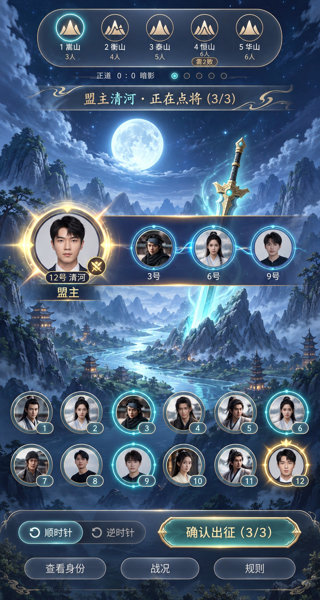

# 《话剑》融合界面确认稿

状态：用户已确认此对局组合方案。用户随后要求先审阅其他核心页面的同风格示例，再统一改代码，因此目前仍是设计预览，尚未修改应用代码、Docker 或 ngrok。整套示例见[核心页面确认稿](../huajian-core-ui-review-20261017/README.md)。生成方式：内置 imagegen；完整提示词见 [generation-prompt.txt](generation-prompt.txt)。

## 历史核对

只读读取 Antigravity 对话 `672c689d-d453-48a1-9fc4-54790444fc3b` 的用户消息及设计稿，时间为北京时间 2026-10-16：

- 第 1064 步：五次任务保留数字 1–5，同时用五岳名称和场景设计。
- 第 1351 步（19:49）：用户提出“方案三的主界面，在中间区域按方案6的组队样式显示”，并要求与圆桌融合方案比较。
- 设计稿 `game_board_ui_schemes_preview.md` 明确推荐方案 A：高透毛玻璃主界面 + 中间队长大头像与入阵槽位横幅 + 下部悬浮玩家头像。
- 第 1358 步（19:55）：用户确认执行。
- 第 1592 步（20:51）：要求更新有剑背景、玩家区域与五轮任务区域，强调保留功能；没有撤销此前的选人横幅方案。
- 本次用户再次明确：截图1的背景、明亮风格、玩家清单和任务图案，组合截图2的选人区域；确认 UI 后再改代码。

前次接管只落实了末条换背景要求，误删了已确认的中部组队横幅。这份预览恢复两种风格的组合。

## 预览

示意为十二人局第1轮，需3人：12号清河担任盟主，3、6、9号已入选。人物头像为占位示意，正式实现使用玩家设置的头像；公开区域不展示私密角色。

## 已确认的设计方向

1. 背景：明亮青蓝月光、山水、巨剑；半透明控件，保持景物可见。
2. 顶部：五个山峰徽章，保留编号1–5、五岳名称、任务人数、两败提示、流局计数及记录入口。
3. 中部：完整保留方案6横幅。左侧金色大头像展示本轮盟主；右侧青色流光圆环展示本轮出征队伍。队长与出征队员分开表示，队长可自行入选，但不会自动占名额。
4. 下方：全体玩家的悬浮头像阵列，与中部已选队员摘要同时存在；座位唯一、选中态同步。
5. 底部：顺／逆时针、确认出征、身份、战况、规则；后续按阶段显示相应操作，不新增聊天、好友或排行榜。

## 交互与适配计划（尚未实施）

- 点击下方玩家头像，填入中部对应队员槽位；再次点击可取消。未满的槽位显示空圆环与待选提示。
- 本轮人数满额后才允许确认。现有权限、方向选择、提交逻辑和游戏规则不变。
- 2–3个出征槽位采用一排；4–6个在手机上采用右侧两排，仍保留左侧队长大头像。槽位数量来自现有任务配置。
- 等待、讨论、表决、执行阶段按现有状态展示队伍和提示；轮间阶段区分候任队长，避免误导当前可以选人。
- 保留5–12人适配；常规手机十二人六列两排，窄屏允许合理换行与纵向滚动，优先保证点击区域和文字清晰。
- 示意图用于确认布局、亮度和装饰风格；头像、文字与状态由代码实时渲染，不将整张图直接用作游戏界面。

此对局方向已确认；等待用户确认整套核心页面示例后，再统一进入实现和验证阶段。
