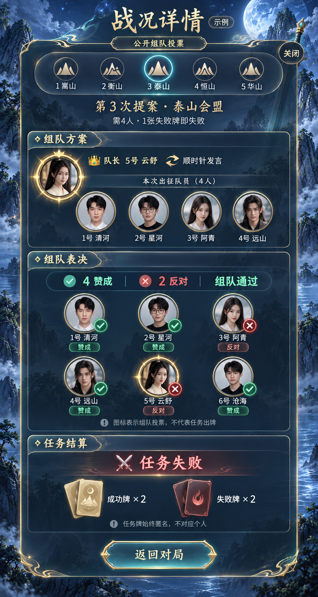
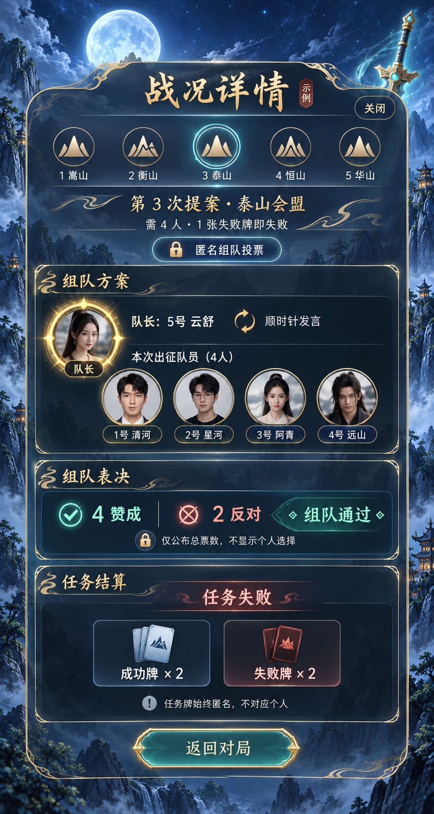

# 《话剑》六场景背景与战况详情确认稿

日期：2026-10-17。**六张背景与两版战况均已由用户确认，已授权并完成本地代码实施。Docker/ngrok 尚未更新。**

最新实现、实拍和验证结果见[六场景 UI 落地记录](../../docs/huajian-scenes-ui-validation.md)。以下内容保留设计阶段的决策依据；末节“只读核对”与摘要指设计阶段当时的状态。

用户已认可原十页的字体、图案与排布，本轮仅补充背景场景分工和战况可视化。此前“从六张中选三至四张”的计划，已被最新要求“六张都用到十页”替代。

## 十页、四类、六张背景

| 页面类别 | 页面 | 背景 | 场景用途 |
| --- | --- | --- | --- |
| 初入江湖 | 1 昵称入口；2 游戏大厅 | A 云海山门 | 山门和云海表现进入江湖，两页保持流程连续 |
| 聚义论剑 | 3 房间等待 | C 松亭会盟 | 松亭、露台营造朋友入席聚会感 |
| 聚义论剑 | 4 对局主界面 | B 月峡剑阵 | 巨剑与明月作为正在对局的核心场景 |
| 秘卷研习 | 5 房间设置；7 游戏规则；8 角色介绍 | D 竹院藏卷 | 静谧书院用于设置与阅读 |
| 秘卷研习 | 6 私密身份牌 | E 寒潭观心 | 独立、安静的查阅身份场景 |
| 江湖留名 | 9 个人中心与战绩；10 终局与复盘入口 | F 五岳破晓 | 用破晓云海呈现回顾与收束，背景本身不带胜负暗示 |

同一页面固定使用对应场景，不每次随机变化。保留已确认的字体、按钮、边框、徽章和布局。对局“队长大头像 + 出征队员槽位”横幅仍是已确认要求，必须保留。

## 六张背景

| A 云海山门 | B 月峡剑阵 | C 松亭会盟 |
| --- | --- | --- |
|  |  |  |

| D 竹院藏卷 | E 寒潭观心 | F 五岳破晓 |
| --- | --- | --- |
|  |  |  |

六张均为独立竖版背景候选原图，不包含文字、按钮或人物。使用内置 imagegen，参考已确认的组合稿生成；完整提示词保存在 [prompts](prompts/)。

实际应用时按页面设置裁切焦点，并在文字背后使用局部通透面板，不能为适配文字给整张图覆盖重黑蒙版。A/F较亮区域需要单独核对文字对比。避免背景与角色头像争夺注意力。

## 战况详情：两种模式

| 公开组队投票 | 匿名组队投票 |
| --- | --- |
|  |  |

示例沿用上传截图的结构：第3次提案、泰山会盟、6人局需4人、队长5号、出征队员1–4号，任务成功牌2张/失败牌2张。为了看清正反两种标记，设计图采用“4赞成、2反对”的虚拟票数，头像与名字也为示意；原截图实际6赞成/0反对记录不被修改。

### 公共结构

1. 五岳任务切换：山峰徽章 + 数字 + 名称，当前任务高亮；保留本轮人数和失败门槛。
2. 组队方案：队长头像、席号与昵称、发言方向；出征队伍使用玩家头像 + 席号 + 昵称。
3. 组队表决：赞成/反对总数和通过/流局结果。
4. 任务结算：结果标题，以及“成功牌 × N / 失败牌 × N”图标计数。
5. 同任务多次提案按先后排列，每次都保留对应队长和队伍，不能覆盖之前流局的提案。

### 公开投票

- 收齐并公开票型后，显示全体玩家头像及各自赞反标识；不能只显示入选队员，因为全员都参与组队投票。
- 赞成使用青绿勾号，反对使用朱红叉号，同时辅以短文字。颜色表达的是投票态度，不能被解读成角色阵营。
- 席号、昵称与图标保持对应。出征队伍区域和全员表决区域分开，避免误以为入选就代表赞成。
- 本轮未收齐/未公布时，只展示等待状态，不显示任何已投玩家的具体选择。

### 匿名投票

- 组队方案仍显示队长与出征玩家头像、席号、昵称。
- 投票区域仅显示总票数和通过/流局结果，移除个人票型头像网格。
- 任何玩家头像都不附赞成/反对图标，也不通过颜色、排序、角标、提示文本泄露个人投票。
- 匿名状态由房间设置决定，不提供一个可在详情里临时“切回公开”的查看开关。

### 两种模式共同保持的匿名性

任务成功/失败牌始终只按总数展示，永远不对应某个玩家；即使组队投票公开，也不能将个人赞反标识当作其任务出牌。组队方案始终公开。

### 覆盖范围

统一用于五岳单轮详情、全部战况、历史复盘中的逐轮记录；复盘权限、匿名投票、任务匿名和未完成提案的现有规则保持不变。对局内战况弹层继承 B 剑峡背景，历史复盘入口继承 F 破晓背景，避免反复跳换场景。身份牌使用 E 寒潭作为其内部背景。

## 只读代码核对与后续边界

当前 GamePanel 两处详情已经通过 anonymousTeamVote 与 ballots 控制个人票型；本轮只检查了源码并画图，尚未替换文字名单、未改接口或游戏规则。实现时需检查头像来源，在复盘缺少玩家图像资料时保留席号/昵称和中性占位头像，不能以角色画像代替账号头像。

应用代码与部署配置前后摘要一致：`7eb6cb33f34a6030d614ec48efbe4c83e86a9a32de9d1db0ffe462652577eadc`。没有构建、部署、改动房间或战绩数据。等待用户确认战况样式后，再按整套设计实施。
