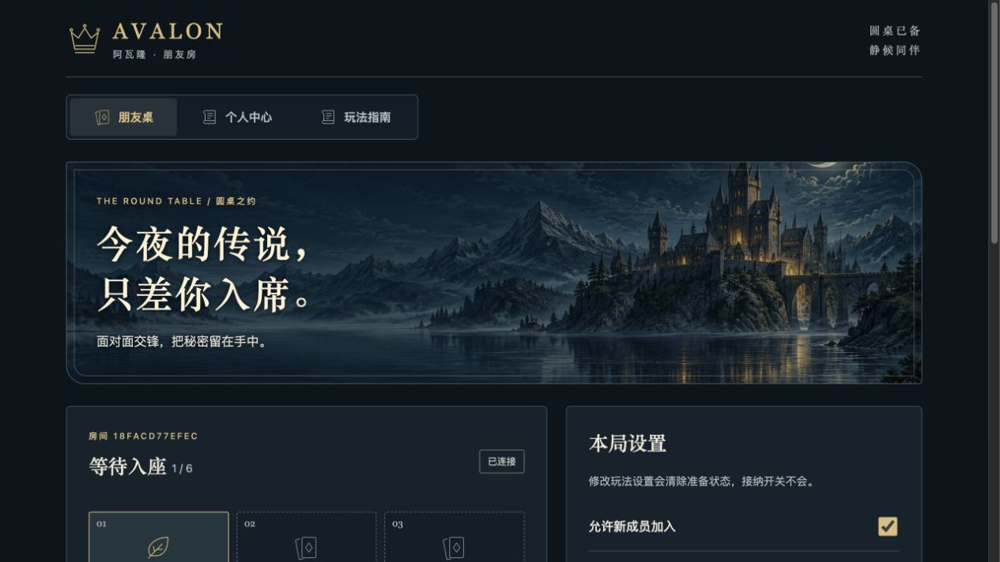
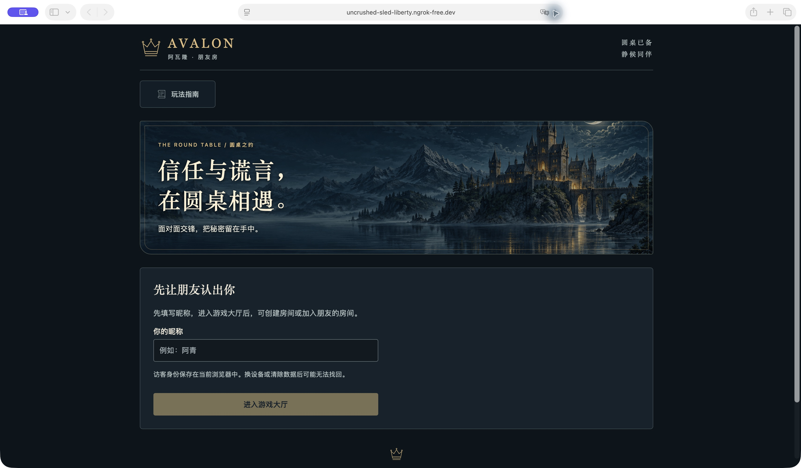
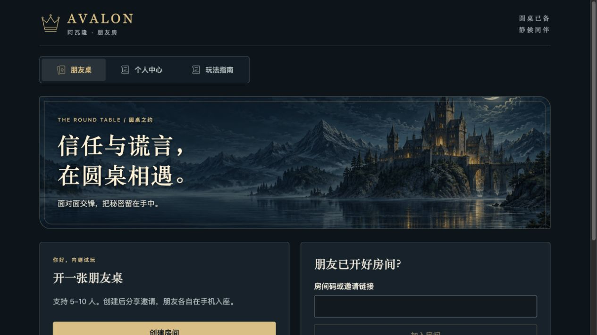

# Docker + ngrok 朋友内测验证记录

日期：2026-09-30，时间均为北京时间。状态：技术验收通过，可以邀请朋友开展真机内测；尚未标记为ECS正式发布版本。

## 环境与交付

- 公网入口：`https://uncrushed-sled-liberty.ngrok-free.dev/`。
- 独立项目：`avalon-stage7-friends`，镜像标签`friends-20260930`；网关仅映射`127.0.0.1:8089`，数据库和后端仅在容器网络内。
- 实际使用本机已配置的ngrok账号，HTTPS入口转发8089，inspect关闭。本次未修改ngrok认证文件，未购买资源或修改域名DNS。
- 原开发实例及`avalon-stage7-local`的8088试玩实例保持独立，未清理其房间或数据库。
- 新增专用Compose叠加配置、配置生成脚本、隧道启停／状态脚本及公网完整对局验收脚本。启动、停止、备份与邀请操作见[朋友内测指南](friends-test.md)。

## 已完成的技术检查

| 检查 | 实际结果 | 证据 |
| --- | --- | --- |
| 规则、持久化、会话、权限、连接恢复及配置回归 | 71项通过，0失败、0跳过；使用真实PostgreSQL | `deploy/evidence/friends-regression-tests.log` |
| 类型与构建 | `npm run build`包含类型检查并生成网页；`npm run build:server`成功 | 本次构建输出及两份容器镜像 |
| 部署配置 | Compose配置解析通过；新网关在无网络临时容器中通过本地HTTPS配置验证 | Compose `config --quiet`、Caddy `validate`成功 |
| 容器 | gateway运行，server／postgres健康；只有8089绑定回环地址 | `deploy -- friends status` |
| 公网完整对局 | 13:57–13:59完成6组验收，全部通过 | [公网验收报告](../deploy/evidence/friends-smoke-1790747940458.json) |
| 隧道启停 | 同名端点重复启动复用；停止后状态为空；原agent恢复同一地址成功，随后公网health为200 | `tunnel -- friends stop/status/start/status`实际演练 |
| 备份 | PostgreSQL custom备份及清单已生成；恢复工作后再次核对SHA-256和字节数一致 | [恢复工作复核记录](../deploy/evidence/friends-resume-check.json) |

公网6组验收具体覆盖：

1. HTTPS健康检查、生产静态资源与安全响应头。
2. 七个独立Secure／HttpOnly／SameSite访客会话、五人WSS连接、邀请加入、关闭接纳、新人被拒、旧成员重连、会话续期、重复命令；HTTP与WSS跨源被拒。
3. 五人标准局：全员准备 → 同步5秒发牌且期间无私密身份 → 本人身份确认 → 三个成功任务 → 正常刺杀未命中 → 蓝方胜 → 统计与三轮复盘。非参与者读取复盘返回404，隐藏该局存在。
4. 同房再开七人拓展局：新成员加入 → 发牌确认 → 两个任务 → 湖中女神查验与本人确认 → 提前刺杀命中 → 红方胜。房主统计为两局、历史为两条，复盘含女神记录。
5. 测试玩家全部离开后空房关闭，现有其他房间保持不变。
6. 伪造不同X-Forwarded-For不能获得新的访客限流额度。

两次调试运行中修正了验收脚本的预期和同步：私密复盘按既有设计返回404而非403；退出测试房间后需等待其他连接收到新版本再发下一条退出命令。修正后完整重跑成功。没有为使测试通过而放宽应用权限或版本校验。测试访客及历史保留；未强删失败运行的测试房间，由原有离线清理流程处理。

## 浏览器验证

已在真实公网入口完成昵称登录、创建朋友房、准备、打开游戏规则与八角色说明、返回房间及刷新恢复。八张角色插画的实际img均加载成功。暂停前，隧道停止再恢复后，浏览器回到原房间、原座位、原准备状态并显示“已连接”。

首次出现ngrok的Visit Site页面，经用户明确同意继续访问后完成网页验证。此页面保留给朋友正常确认，未通过修改User-Agent或注入请求头隐藏提示。

17:27恢复工作时重新确认：同一ngrok端点仍转发8089，容器持续运行且数据库／后端健康，公网`/api/health`返回200与PostgreSQL状态，备份校验通过。本轮浏览器控制工具连接两次超时，因此没有将旧截图或此前网页验证描述为17:27重新执行；网页截图与交互证据来自暂停前的同一次部署。恢复后只补充文档和保存证据，未修改业务代码或重复创建验收玩家。

备份：`deploy/backups/avalon-stage7-friends-2026-09-30T05-59-19-270Z.dump`及同名`.json`，45199字节，包含001／002／003迁移。备份包含私密对局数据，应留在本机私密目录，不分享给朋友。备份完整还原能力已在[阶段7演练](stage-7-validation.md)验证；此次对朋友实例备份做了完整性核对，没有覆盖或还原现有数据库。

## 仍需朋友完成

| 项目 | 状态 | 记录 |
| --- | --- | --- |
| iPhone微信打开邀请、登录、角色图片、玩法指南 | 待验收 | 手机型号／系统／微信版本、是否能完成 |
| Android微信相同流程 | 待验收 | 手机型号／系统／微信版本、是否能完成 |
| Wi-Fi与移动网络访问，切聊天、锁屏及网络切换后的重连 | 待验收 | 原身份／座位／投票是否恢复，卡住阶段 |
| 五位朋友实际完成标准局，并同房再开 | 待验收 | 日期、房间码、结果、体验问题 |
| 七位朋友实际完成女神及提前刺杀拓展局 | 待验收 | 日期、房间码、结果、体验问题 |

不以桌面浏览器或程序模拟代替上述验收。全部完成并修复阻断问题后，再确认ECS购买、域名接入和正式上线安排。

## 2026-10-10：昵称入口文案优化

保留“填写昵称 → 游戏大厅 → 创建或加入房间”的流程。首次进入按钮由“进入朋友房”改为“进入游戏大厅”，处理中显示“正在进入大厅…”。表单新增说明：“先填写昵称，进入游戏大厅后，可创建房间或加入朋友的房间。”输入框通过 `aria-describedby` 关联流程说明及原访客身份提示。

- `npm run build` 的 TypeScript 检查与 Vite 构建通过；Docker 构建同时完成网页及后端构建。
- 更新前确认无活动房间、在线成员或进行中的对局，并生成 `deploy/backups/avalon-stage7-friends-2026-10-10T02-08-48-994Z.dump` 及备份清单。
- 朋友实例已切换到 `friends-20261010-lobby-entry` 镜像；保留旧镜像及原数据库卷。原8088实例未改动，ngrok仍使用同一公网地址转发8089。
- 更新后容器启动检查通过，后端和PostgreSQL健康；公网 `/api/health` 返回 `status: ok`、`storage: postgresql`。
- Safari普通窗口刷新后显示新说明和新按钮；空昵称时按钮保持禁用。内置浏览器已有访客身份仍正常进入大厅，创建与加入入口同时可见。
- 在Safari独立隐私窗口用“入口文案验收”提交昵称，确认按钮先显示“正在进入大厅…”，随后到达大厅并同时显示“创建房间”和“加入房间”。未创建测试房间；完成后关闭临时窗口，保留原Safari页面待用户自行填写昵称。

本次为入口文案修改，执行类型检查、构建与针对性浏览器验证；未重复运行上文9月30日的71项回归或完整对局脚本。手机微信和朋友实局仍按上表单独验收。

## 2026-10-13 18:32：朋友实局前访问检查

- 初查时应用容器持续运行，后端及PostgreSQL健康；ngrok未运行本实例端点，公网健康请求返回404。
- 使用既有 `npm run tunnel -- friends start` 恢复此前已授权的同一入口：`https://uncrushed-sled-liberty.ngrok-free.dev` → `http://127.0.0.1:8089`。没有修改应用、数据库、镜像或公网地址。
- 恢复后 `tunnel status` 确认转发运行；公网 `/api/health` 返回HTTP 200，内容为 `status: ok`、`storage: postgresql`。
- 内置浏览器实际打开同一公网网页，已有访客恢复成功，大厅“创建房间”和“加入房间”入口正常显示。
- 本次未创建房间、未运行完整对局脚本或访客限流测试，不影响接下来的朋友入场。手机网络、完整实局及同房再开由本次朋友测试验收，不能用本轮访问检查代替。
- ngrok以前台进程持续运行；测试期间须保持Mac联网、不睡眠、不合盖，Docker和ngrok均保持运行。实局步骤已补充到[朋友内测指南](friends-test.md#首次完整实局速查)。

## 2026-10-14 20:22：修复隧道随检查会话失效

用户再次报告打不开后，复现了本机无ngrok进程、无本实例端点的状态；前一次检查时HTTP 200不能证明检查结束后的可用性。旧脚本在agent不存在时启动前台子进程，生命周期依赖执行它的命令会话。

修复：macOS的 `tunnel -- friends start` 改用用户会话launchd运行独立agent，并等待名称、地址、上游与inspect配置全部匹配后返回成功。项目目录中的私密plist明确设置 `KeepAlive: false`，没有安装开机／登录自启动；保留 `foreground` 供明确的前台排查使用。已有agent继续复用，停止仍只删除本实例端点。应用容器、数据库及公网地址未改变。

验证结果：

- 部署配置与隧道启动就绪／超时／配置冲突等5项针对性测试全部通过，脚本语法检查通过。
- 启动命令已正常退出；后续独立命令确认ngrok仍由PID 1管理，launchd状态为running、无keepalive属性。
- 在确认没有玩家或活动房间后演练停止／恢复：停止12秒后端点仍关闭，其他端点集合保持不变；恢复后重复启动安全复用。
- 公网健康接口恢复HTTP 200与PostgreSQL健康；浏览器重新加载后成功恢复已有访客，大厅创建／加入入口均显示。
- [运行证据](../deploy/evidence/friends-tunnel-background-20261014.json)记录20:22复核的进程归属、配置及健康结果。本次不重跑完整对局，朋友实局和手机微信验收仍单独记录。

## 2026-10-15 11:23：修复提前刺杀轮间确认队长误导与死锁

针对 2026-10-14 晚 10 人局在第 2 轮任务结束进入第 3 轮时，因开启“提前刺杀”导致进入 `early_window` 阶段且界面误显“当前队长：3 号 子容”造成选人入口不可见与操作死锁的问题进行排查修复：

- **根本原因**：第 2 轮任务结算后触发提前刺杀窗口，阶段为 `early_window`；组队选人表单需 `g.phase === 'proposing'`，故未渲染；推进对局的操作（刺客“本次跳过”）被折叠在刺客私密身份卡片内，且主界面提示误显“当前队长：3 号 子容”，导致队长与全桌误认为已进入组队阶段，陷入死锁。
- **界面与交互修正**：
  1. `GamePanel.tsx`：在 `early_window`、`lady`、`lady_reveal` 等轮间过渡阶段，队长文案修正为“下一轮队长：XX（待本阶段确认完成后开始选人组队）”，队长本人提示“（你）”，消除选人时机误解；
  2. `GamePanel.tsx`：轮间确认阶段全员身份按钮统一动态强化为“私下查看我的身份（有操作待处理）”，既不暴露刺客身份，又能强力提示刺客主动操作；
  3. `Extensions.tsx`：`ExtensionStep` 主提示明确引导刺客打开身份面板选择发起刺杀或跳过；刺客私密面板内按钮明确为“本次跳过，开始组队”；非刺客打开身份时明确提示非刺客无需操作，耐心等待。
- **验证与发布**：
  - 更新并补充测试用例，`npm run typecheck` 通过，29 项单元与逻辑测试全部通过；
  - 升级前完成数据库备份：`deploy/backups/avalon-stage7-friends-2026-10-15T03-22-28-742Z.dump`；
  - 镜像标签升级为 `friends-20261015-early-window-fix`，完成构建并以 `npm run deploy -- friends up` 重新部署；
  - 本地与公网健康检查 `https://uncrushed-sled-liberty.ngrok-free.dev/api/health` 均返回 HTTP 200，PostgreSQL 持久化健康。

