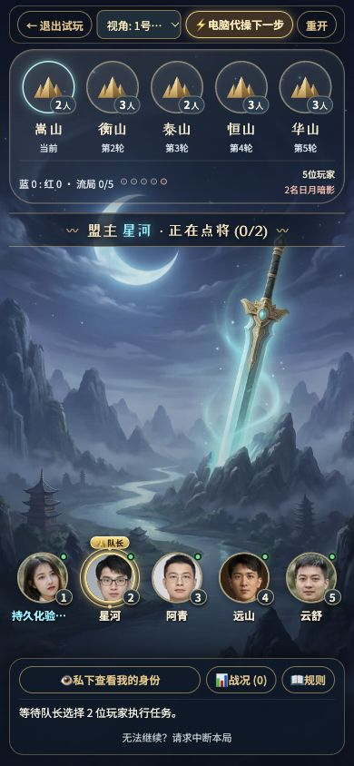
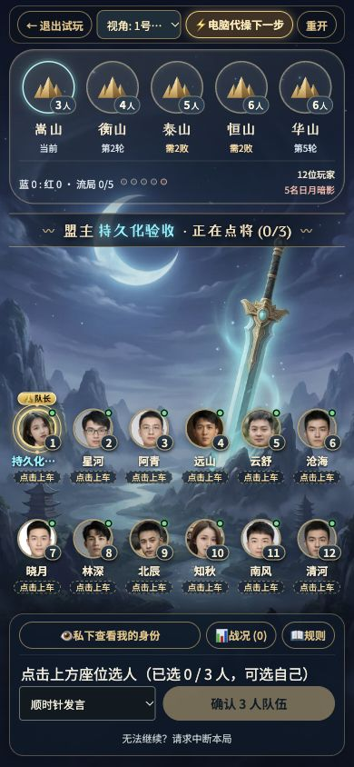
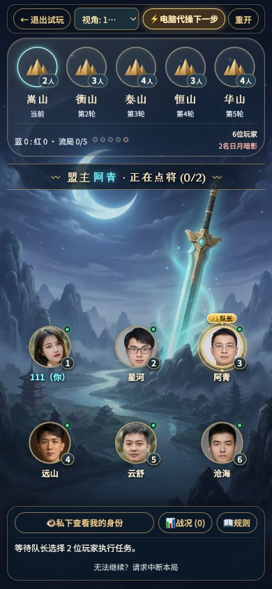

# 《话剑》剑景界面接管与验证

验证日期：2026-10-16。运行地址：http://localhost:5173/。

## 接管依据

只读读取 Antigravity 对话 `672c689d-d453-48a1-9fc4-54790444fc3b` 的本地 SQLite 记录和原始附件，定位到轨迹 `91a9412d-e26d-4e36-9f67-25788a0d7c5c` 第 1592 步的用户要求：

> 对比游戏当前的页面背景，我更喜欢这版有剑的风格，和游戏名称更搭，为何不切换成这样呢，而且这个UI的玩家列表区域、5轮对局局域也做得更美观，请修改成这个风格，在保留功能的基础上，风格尽量与这个相近。

参考图：脑目录 `.user_uploaded/media_1792154962098_47a72fc7.jpg`。接管前已生成剑景素材，并部分修改 JSX；`sword-moon-vista-spacer` 与 `seat-aura-ring` 尚无样式，五轮任务文字重叠、玩家底板遮挡背景。保留已选角色图案、角色映射、5–12 人规则及原有工作区内容。原始修改与素材已备份到 `tmp/takeover-20261016/before/`。

## 本轮完成

- 沿用已生成的明月、巨剑、山水 WebP 背景，保留中央景观空间，让空间优先随视口和操作内容收缩。
- 等待区和对局复用 `QuestMedallion`：山岳图案、出征人数、轮次名称与状态分层展示；保留两张失败牌门槛及点击查看组队、表决、任务记录的入口。
- 流局改为紧凑计数点，保留比分、计数、阵营人数，避免挤压五轮徽章。
- 去掉玩家区域的整块模糊底板，采用悬浮圆形头像、席号胶囊和队长／入阵光环。五人单排、六人两排、十二人在常规手机上六列两排；窄屏调整为四列并允许纵向滚动。
- 保留组队、讨论、表决、任务出牌、身份牌、规则、历史、终局与房间设置。空座邀请补上 Enter／空格操作，选人增加可读名称与选中状态。
- 清理已删除组队横幅的无用样式；未改变服务端游戏规则或数据库结构。

## 自动检查

- `npm run build`：类型检查和 Vite 生产构建通过。
- `npm test`：78 项通过，0 失败、0 跳过，使用真实 PostgreSQL 隔离测试 schema。
- `git diff --check`：通过。
- 首轮发现一个接管前已过时的测试：写死迁移数量为 3，当前已有 5 个迁移。改为比较迁移被拒绝前后的版本列表，继续验证活动服务锁，不再依赖固定数量；单项和全套复测通过。

日志：`tmp/takeover-20261016/tests-final.log`；单项复测：`config-retest.log`。

## 浏览器检查

- 390 × 844：创建十二人本地等待房，准备状态同步；改成五人后准备状态重置；正常退出测试房。
- 五人、六人、十二人头像与任务配置均检查；十二人 390 × 844 页面宽度 390、内容高度 844，可完整显示；公共座位挂载角色图案数量为 0。
- 320 × 667：十二人页面宽度和 main 内容宽度均为 320，无横向溢出；内容允许纵向滚动，试玩视角选择器改为分行展示。
- 六人隔离试玩：手动选人、确认队伍、开始表决、提交赞成、提交成功任务牌；徽章成功状态及当轮历史详情正确。继续电脑代操走到红方三次任务失败获胜，最终角色公开。
- 私密身份可打开和关闭；规则可打开并返回原页面。
- 修改入口文件时热更新曾记录一次 `createRoot` 警告；完整刷新后未新增运行错误。

## 截图

五人对局：

十二人对局：

[十二人等待房](huajian-sword-ui/waiting-12-390.jpg) · [320 像素窄屏](huajian-sword-ui/playing-12-320.jpg)

## 交付边界

已完成本地代码和验证；用户随后明确授权更新 Docker／ngrok 内测环境，2026-10-16 23:30 完成两套实例升级，详见下节。未提交 Git。浏览器检查使用桌面浏览器尺寸模拟，不能替代朋友在 iPhone／Android 微信中的完整对局验收。

## 2026-10-16 23:35：Docker 与公网更新

- 本地 `http://127.0.0.1:8088` 和朋友内测 `https://uncrushed-sled-liberty.ngrok-free.dev/` 均切换到镜像标签 `huajian-sword-20261016t152755`，使用同一份生产构建。沿用现有 ngrok 隧道，不改变公网地址。
- 切换前分别停止应用写入并完成 PostgreSQL 备份，保留持久卷。迁移后两套实例均为 001–005，升级前后用户、房间、对局数量一致。数据库与后端健康，网关正常运行。
- 旧镜像已保留回退标签。朋友实例原运行镜像 ID 已不可用；对保留的旧标签镜像与运行容器的应用代码做确定性 SHA256 比较，结果一致。完整容器文件系统导出因可能包含敏感文件被自动审批拒绝，未执行；采用核验旧镜像的方式保留回退版本。
- 本地和公网均通过健康接口、HTML、JS／CSS、剑景与角色素材校验；素材 SHA256 与本次构建一致。
- 分别通过两个临时访客验证入房、WebSocket／WSS 准备状态广播、会话续期、断开重连后身份／座位／准备恢复；只清理自身测试房间，未运行访客限流探测。
- 23:34 独立复核公网 `/api/health` 返回 HTTP 200、`status: ok`、`storage: postgresql`。
- 公网浏览器实际加载本次 JS／CSS、剑景背景与头像均为 HTTP 200。六人试玩页面在 390 × 844 下内容宽度 390、高度 844，无横向溢出；所见头像均已加载。首次未登录 `/api/me` 的 401 为身份探测，随后访客创建接口返回 200；未见其他控制台错误。
- CUA 浏览器工具连接超时后，使用可用的 Playwright 浏览器工具完成视觉复核。此处截图为公网桌面浏览器模拟手机视口，尚不代表手机微信验收。

部署、备份与接口验证证据保存在本机私密目录 `deploy/evidence/upgrade-20261016t152755/`；数据库备份位于 `deploy/backups/`，不对外分享。测试期间保持 Mac 联网、不睡眠，Docker 与现有 ngrok 进程持续运行。手机微信、移动网络、真实朋友完整对局仍需单独验收。
